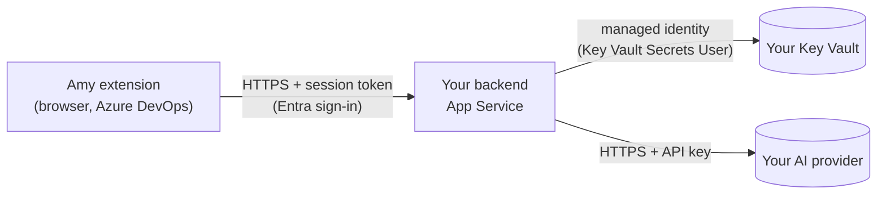

# Deploy the backend

Amy's backend runs in **your** Azure subscription, with **your** AI provider and credentials. It is published as a container image; you don't build anything:

```text
ghcr.io/notsweetenough/amy-backend:<version>     for example 0.2.0
```

This guide deploys it on Azure App Service for Containers, with secrets in Azure Key Vault and a managed identity. About 30 minutes; you need **Contributor** and **User Access Administrator** (or **Owner**) on a resource group, and the right to create an app registration in Microsoft Entra ID.



Replace the placeholders in the commands: `<resource-group>`, `<location>`, `<app>` (globally unique; the backend URL becomes `https://<app>.azurewebsites.net`), `<plan>`, `<key-vault>`, `<tenant-id>`, `<client-id>`, `<organization>` (the name in `https://dev.azure.com/<organization>`). The commands are for PowerShell with the [Azure CLI](https://learn.microsoft.com/cli/azure/install-azure-cli).

## 1. Register the backend in Microsoft Entra ID

Users sign in to the backend with their work account.

1. In the Microsoft Entra admin center, create an app registration (single tenant), for example "Amy backend". Note the **Application (client) ID** (`<client-id>`) and **Directory (tenant) ID** (`<tenant-id>`).
2. Add a **Web** redirect URI: `https://<app>.azurewebsites.net/auth/callback`.
3. Create a **client secret**. You store it in Key Vault in step 3; don't save it anywhere else.
4. Under **API permissions**, check that Microsoft Graph **openid** and **profile** (delegated) are listed, and add **Azure DevOps** delegated permissions **vso.profile**, **vso.wiki**, **vso.work** and **vso.code** (all read-only; not `user_impersonation`). The backend uses vso.profile once at sign-in to check that the user belongs to your Azure DevOps organization, and the others only for the MCP server, acting as the signed-in user.
5. Select **Grant admin consent for <your tenant>**. This needs a Cloud Application Administrator, Application Administrator or Global Administrator. Without it, users are asked for admin approval when they sign in.

Optional: define an app role (for example `Amy.User`), assign it to users or groups, and set `REQUIRED_APP_ROLE` in step 4 to limit who may use Amy.

## 2. Create the App Service and the Key Vault

```powershell
az login
az group create --name "<resource-group>" --location "<location>"
az appservice plan create --name "<plan>" --resource-group "<resource-group>" --is-linux --sku B1
az webapp create --name "<app>" --resource-group "<resource-group>" --plan "<plan>" --container-image-name "ghcr.io/notsweetenough/amy-backend:0.2.0"
az webapp update --name "<app>" --resource-group "<resource-group>" --https-only true
az webapp config set --name "<app>" --resource-group "<resource-group>" --min-tls-version 1.2 --ftps-state Disabled --always-on true
$appId = az webapp show --name "<app>" --resource-group "<resource-group>" --query id -o tsv
az resource update --ids "$appId/config/web" --set properties.healthCheckPath=/api/health

az webapp identity assign --name "<app>" --resource-group "<resource-group>"
$principal = az webapp identity show --name "<app>" --resource-group "<resource-group>" --query principalId -o tsv
az keyvault create --name "<key-vault>" --resource-group "<resource-group>" --location "<location>" --enable-rbac-authorization true
$kvId = az keyvault show --name "<key-vault>" --query id -o tsv
az role assignment create --role "Key Vault Secrets User" --assignee-object-id $principal --assignee-principal-type ServicePrincipal --scope $kvId
$me = az ad signed-in-user show --query id -o tsv
az role assignment create --role "Key Vault Secrets Officer" --assignee-object-id $me --assignee-principal-type User --scope $kvId
```

The image is public; App Service pulls it without registry credentials. Role assignments can take a few minutes to apply.

## 3. Store the secrets

Type each value at the prompt, so it never appears in your command history:

```powershell
function Set-AmySecret($name) {
  $secure = Read-Host -AsSecureString "Value for $name"
  $plain = [Runtime.InteropServices.Marshal]::PtrToStringBSTR([Runtime.InteropServices.Marshal]::SecureStringToBSTR($secure))
  az keyvault secret set --vault-name "<key-vault>" --name $name --value $plain --output none
}
Set-AmySecret "ai-provider-api-key"     # your AI provider's key
Set-AmySecret "entra-client-secret"     # the client secret from step 1
Set-AmySecret "session-signing-key"     # 32+ random characters, see below
```

For the session signing key, generate a value and paste it at the prompt:

```powershell
$bytes = New-Object byte[] 48; [Security.Cryptography.RandomNumberGenerator]::Create().GetBytes($bytes); [Convert]::ToBase64String($bytes)
```

## 4. Configure the backend

```powershell
$kv = "https://<key-vault>.vault.azure.net/secrets"
az webapp config appsettings set --name "<app>" --resource-group "<resource-group>" --output none --settings `
  "WEBSITES_PORT=3001" `
  "AUTH_MODE=entra" `
  "PUBLIC_BASE_URL=https://<app>.azurewebsites.net" `
  "ENTRA_TENANT_ID=<tenant-id>" `
  "ENTRA_CLIENT_ID=<client-id>" `
  "ENTRA_CLIENT_SECRET=@Microsoft.KeyVault(SecretUri=$kv/entra-client-secret/)" `
  "SESSION_SIGNING_KEY=@Microsoft.KeyVault(SecretUri=$kv/session-signing-key/)" `
  "ALLOWED_ORGANIZATIONS=<organization>" `
  "ALLOWED_ORIGINS=https://valorconsulting.gallerycdn.vsassets.io" `
  "AI_PROVIDER=openai-compatible" `
  "AI_PROVIDER_BASE_URL=<chat-completions URL of your provider>" `
  "AI_PROVIDER_MODEL=<model or deployment name>" `
  "AI_PROVIDER_AUTH_HEADER=<header your provider expects, e.g. api-key or authorization>" `
  "AI_PROVIDER_API_KEY=@Microsoft.KeyVault(SecretUri=$kv/ai-provider-api-key/)"
az webapp restart --name "<app>" --resource-group "<resource-group>"
```

- `ALLOWED_ORIGINS` is the address Amy runs from inside Azure DevOps; keep it exactly as shown.
- Several organizations: comma-separate them in `ALLOWED_ORGANIZATIONS`.
- The AI provider settings depend on your provider (API version, `Bearer` scheme, Claude through a Vertex AI-style gateway, a model list for users): [AI-PROVIDER-CONFIGURATION.md](AI-PROVIDER-CONFIGURATION.md). Start with `AI_PROVIDER=mock` (simulated answers, no key) if you want to test the setup first.
- The backend checks its configuration at startup and stops with a message naming the problem setting (never its value): **App Service > Log stream**.

## 5. Verify

```powershell
Invoke-RestMethod "https://<app>.azurewebsites.net/api/health"   # status "healthy" and the backend version
Invoke-RestMethod "https://<app>.azurewebsites.net/api/ready"    # succeeds when the AI provider is configured
```

In the portal, **App Service > Settings > Environment variables** shows a green **Key Vault Reference** status for each secret.

## 6. Connect your Azure DevOps organization

An organization administrator (Project Collection Administrators) opens **Amy** in any project, selects the **Amy logo**, then **Backend settings**, enters `https://<app>.azurewebsites.net`, selects **Test connection** and saves. Each user then confirms the backend once and signs in. Details: [ADMIN-CONFIGURATION.md](ADMIN-CONFIGURATION.md).

## Updating

New backend versions are published as new image tags; see the [package page](https://github.com/users/NotSweetEnough/packages/container/package/amy-backend). Pin a version, and move to a new one deliberately:

```powershell
az webapp config container set --name "<app>" --resource-group "<resource-group>" --container-image-name "ghcr.io/notsweetenough/amy-backend:<new-version>"
az webapp restart --name "<app>" --resource-group "<resource-group>"
```

With web search, the backend is the container named `main`. Update both containers to the new version instead:

```powershell
az webapp sitecontainers update --name "<app>" --resource-group "<resource-group>" --container-name main --image "ghcr.io/notsweetenough/amy-backend:<new-version>"
az webapp sitecontainers update --name "<app>" --resource-group "<resource-group>" --container-name searxng --image "ghcr.io/notsweetenough/amy-searxng:<new-version>"
az webapp restart --name "<app>" --resource-group "<resource-group>"
```

`/api/health` reports the running version. The extension and the backend are versioned independently; the extension works with any backend that offers the API version it needs and explains features a backend doesn't offer.

## Usage and cost controls

Your organization pays for its own AI usage. Set these as app settings; the defaults apply when a setting is absent:

| Setting | Default | Purpose |
| --- | --- | --- |
| `LIMIT_REQUESTS_PER_USER_PER_MINUTE` | 10 | Request rate per user |
| `LIMIT_REQUESTS_PER_USER_PER_DAY` | 200 | Requests per user and day |
| `LIMIT_REQUESTS_PER_ORG_PER_DAY` | 2,000 | Requests per organization and day |
| `LIMIT_REQUESTS_GLOBAL_PER_MONTH` | 50,000 | All requests per month |
| `LIMIT_TOKENS_PER_USER_PER_DAY` | 0 (none) | Tokens per user and day, as reported by your provider |
| `LIMIT_TOKENS_PER_ORG_PER_DAY` / `LIMIT_TOKENS_PER_ORG_PER_MONTH` | 0 (none) | Tokens per organization |
| `MAX_CONCURRENT_REQUESTS` / `MAX_CONCURRENT_REQUESTS_PER_ORG` | 10 / 4 | Concurrent requests |
| `AI_PROVIDER_MAX_OUTPUT_TOKENS` | unset | Output tokens per request |
| `AI_DISABLED` | false | Emergency switch: refuses all AI requests |

Counters are kept in memory: run **one instance** (don't scale the App Service plan out), or each instance counts separately. Logs contain metadata only (operation, organization, pseudonymous user, duration, outcome, token counts), never prompts, content or credentials.

## Optional: pull-request documentation checks

Amy can review completed pull requests on its own and propose Wiki updates for approval ([USER-GUIDE.md](USER-GUIDE.md#review-pull-request-documentation)). The backend then needs storage for proposals and read access to Azure DevOps.

1. **Storage** (no account keys; the app identity gets access to one container):

   ```powershell
   az storage account create --name "<storage>" --resource-group "<resource-group>" --location "<location>" --sku Standard_LRS --min-tls-version TLS1_2 --allow-shared-key-access false --allow-blob-public-access false
   $st = az storage account show --name "<storage>" --resource-group "<resource-group>" --query id -o tsv
   az role assignment create --role "Storage Blob Data Contributor" --assignee-object-id $me --assignee-principal-type User --scope $st
   az storage container create --account-name "<storage>" --name "amy-state" --auth-mode login
   az role assignment create --role "Storage Blob Data Contributor" --assignee-object-id $principal --assignee-principal-type ServicePrincipal --scope "$st/blobServices/default/containers/amy-state"
   ```

2. **Hook secret:** `Set-AmySecret "pr-docs-hook-secret"` with 32+ random characters (generated as in step 3).
3. **Settings:**

   ```powershell
   az webapp config appsettings set --name "<app>" --resource-group "<resource-group>" --output none --settings `
     "PR_DOCS_ENABLED=true" `
     "PR_DOCS_HOOK_SECRET=@Microsoft.KeyVault(SecretUri=$kv/pr-docs-hook-secret/)" `
     "ADO_AUTH_MODE=managed-identity" `
     "STATE_STORE=blob" `
     "STATE_BLOB_CONTAINER_URL=https://<storage>.blob.core.windows.net/amy-state"
   ```

4. **Azure DevOps access for the backend:** in **Organization settings > Users**, add the App Service's managed identity (`$principal`) with **Basic** access. Grant it **Read** on the repositories and Wikis to check, and **Contribute to pull requests** on those repositories (for the reviewer notification). Nothing else.
5. **Who may change the checks:** add the app role `Amy.Admin` to the app registration from step 1 and assign it to those people.
6. **Choose repositories and reviewers** in Amy: **Amy logo > Backend settings > Pull-request documentation checks**.
7. **Service hook**, in each project: **Project settings > Service hooks > + > Web Hooks**, event **Pull request updated**, URL `https://<app>.azurewebsites.net/api/hooks/pull-request`, HTTP header `x-amy-hook-secret:<the pr-docs-hook-secret value>`, resource details **All**.

## Optional: MCP server for AI clients

AI clients that support the Model Context Protocol (for example VS Code) can use Amy's tools at `https://<app>.azurewebsites.net/mcp`. Users sign in with Entra ID and Azure DevOps is read with their own permissions; anything that would change content becomes a proposal they approve in Amy.

1. On the app registration: under **Expose an API**, set the Application ID URI (`api://<client-id>`) and add the delegated scope `Amy.Mcp`; in the manifest set `"accessTokenAcceptedVersion": 2`.
2. Set `MCP_ENABLED=true`, plus `STATE_STORE` and `STATE_BLOB_CONTAINER_URL` as for pull-request checks.
3. In the client, use the URL and the header `x-azdo-organization: <organization>`.

## Optional: web search

Questions can search the web when the Wiki doesn't answer them, or when the user asks for it (backend 0.11.2 or later). The backend uses [SearXNG](https://docs.searxng.org/), a free, self-hosted metasearch engine that passes the question to public search engines (for example Bing, DuckDuckGo, Brave and Wikipedia). It runs as a second container, a sidecar, in the backend's App Service: only the backend reaches it, at `http://localhost:8888`, and it needs no other Azure resources. The `amy-searxng` image is SearXNG with the settings the backend needs; use the backend's version.

1. **Secret:** `Set-AmySecret "searxng-secret"` with 32+ random characters (generated as in step 3).
2. **Sidecar mode:** an app with a single container takes sidecars once it's converted. The backend becomes the container named `main`, with its image and port unchanged:

   ```powershell
   az webapp sitecontainers convert --mode sitecontainers --name "<app>" --resource-group "<resource-group>"
   ```

3. **The SearXNG container:**

   ```powershell
   az webapp sitecontainers create --name "<app>" --resource-group "<resource-group>" `
     --container-name searxng --image "ghcr.io/notsweetenough/amy-searxng:<version>" --target-port 8888
   ```

4. **Settings.** App settings reach every container, so SearXNG reads its secret from here:

   ```powershell
   az webapp config appsettings set --name "<app>" --resource-group "<resource-group>" --output none --settings `
     "WEB_SEARCH_PROVIDER=searxng" `
     "WEB_SEARCH_BASE_URL=http://localhost:8888" `
     "SEARXNG_SECRET=@Microsoft.KeyVault(SecretUri=$kv/searxng-secret/)"
   az webapp restart --name "<app>" --resource-group "<resource-group>"
   ```

5. **Check:** turn on **Web search** in Amy's settings and ask "Search the web for …". **App Service > Log stream** shows `Web search completed` with the number of results. With `statusCategory: network`, the SearXNG container isn't running; its log: `az webapp sitecontainers log --name "<app>" --resource-group "<resource-group>" --container-name searxng`.

Only the question leaves the backend: SearXNG passes it to the search engines without user information, and they see the App Service's outbound address. Search engines may block data-center addresses, Google most often; SearXNG then pauses that engine for a while and answers from the others. SearXNG is open source under the AGPL-3.0 license ([source](https://github.com/searxng/searxng)); the `amy-searxng` image adds only its settings.

## Rotating secrets

1. Create a **new version** of the secret in Key Vault (`ai-provider-api-key`, `entra-client-secret`, `session-signing-key`, `pr-docs-hook-secret` or `searxng-secret`). The app settings don't change: the references always use the latest version.
2. Restart the app (`az webapp restart ...`) to use it immediately; otherwise App Service picks it up within a day.
3. Check that AI requests work, then revoke the old credential at its source. Rotating `session-signing-key` signs everyone out; rotating `pr-docs-hook-secret` needs the new value in each service hook.

## Networking

The defaults above give: HTTPS only with TLS 1.2+, Entra sign-in required, CORS limited to Amy's origin, Key Vault readable only by the app identity, and outbound HTTPS from App Service to your AI provider (with web search, also from SearXNG to the public search engines).

Where required, add App Service VNet integration (with all outbound traffic routed through the VNet) for a private AI endpoint or Key Vault, a Key Vault private endpoint with the `privatelink.vaultcore.azure.net` DNS zone, and access restrictions on the backend. Behind a proxy, set `HTTPS_PROXY` and `NODE_USE_ENV_PROXY=1`.

## Troubleshooting

| Symptom | Check |
| --- | --- |
| The app doesn't start; the log stream names a setting | Fill that setting. Placeholders such as `<app>` are rejected. |
| `unresolved Key Vault reference` | The secret exists, the app identity has **Key Vault Secrets User**, the vault name in the reference is right, and the network can reach the vault. |
| `/api/ready` fails | The AI provider settings are incomplete. |
| Test connection in Amy fails with "could not be reached" | The URL starts with `https://` and has nothing after the host; `ALLOWED_ORIGINS` is exactly as in step 4. |
| Users are asked for admin approval when signing in | Step 1.5: grant admin consent. |
| "The AI provider could not be reached" | Outbound access to the provider, the URL, or a proxy (see Networking). |
| `Web search failed` with `status: 403` in the log | The SearXNG container must use the `amy-searxng` image: plain SearXNG refuses the backend's JSON requests. |
| AI requests fail with HTTP 400 for newer Claude models | Leave `AI_PROVIDER_TEMPERATURE` empty: Claude 4.7 and later reject it. |
